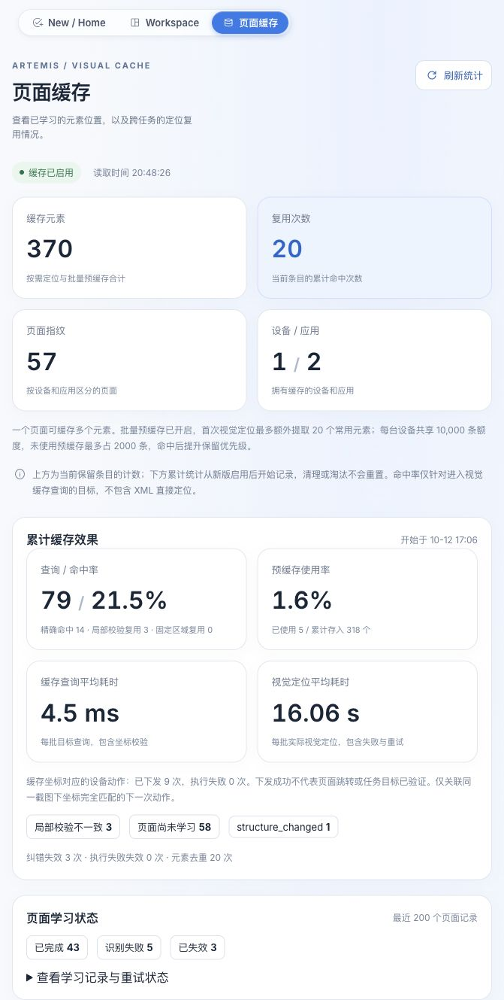

<p align="center">
  
</p>

<p align="center">
  <strong>Let AI assistants and test suites use real phones like a human.</strong>
</p>

<p align="center">
  <a href="./README.md"><b>English</b></a> •
  <a href="./README_CN.md">中文文档</a> •
  <a href="#workflow-showcase">Workflow Showcase</a> •
  <a href="#fork-features">Fork Features</a> •
  <a href="#model-configuration">Model Configuration</a> •
  <a href="#visual-location-cache">Cache Dashboard</a> •
  <a href="#quick-start">Quick Start</a> •
  <a href="#device-selection">Device Selection</a> •
  <a href="#ios-simulator">iOS Support</a> •
  <a href="#mcp-setup">MCP for IDEs</a> •
  <a href="#benchmarks">Benchmarks</a> •
  <a href="https://discord.gg/wF2FN4WHGY">Discord Community</a>
</p>

<p align="center">
  <a href="https://www.python.org/downloads/"></a>
  <a href="LICENSE"></a>
  <a href="https://modelcontextprotocol.io/"></a>
  <a href="./docs/codex-client-provider.md"></a>
  <a href="https://ai.google.dev/"></a>
  <a href="https://github.com/google-research/android_world"></a>
</p>

<a id="fork-features"></a>
<a id="codex-client-integration"></a>
## Fork Additions and Enhancements

> [!NOTE]
> This repository is a community fork of [google/artemis](https://github.com/google/artemis), retaining upstream authorship and the Apache 2.0 license. The table below covers this fork's extensions; the later highlights, Flash/Pro profiles, and AndroidWorld results describe ARTEMIS's general capabilities.

| Area | Main capabilities |
|---|---|
| **Codex integration** | Reuse the local ChatGPT login for core workflows without a separate model API key. Prefer the desktop client's bundled Codex and configure models by role. [Setup and configuration](#model-configuration) |
| **Cache and runtime improvements** | Reuse visual positions to reduce repeated locating, with dashboard search, failure cases, and estimated savings; add image compression, deferred Flash summaries, and capture/history loading improvements. [Cache guide](#visual-location-cache) · [Timing records](./docs/model-call-performance.md) |
| **Platforms and devices** | Shared Windows/macOS/Linux setup and diagnostics, physical-first selection, AVD discovery and reuse, plus iOS Simulator and physical-device drivers. Live automated iPhone tap acceptance remains pending. [Setup](#quick-start) · [Devices](#device-selection) · [iOS](#ios-simulator) |

Codex requires a signed-in client with access to the selected models; cloud OCR and other API providers still need their own keys. Cache savings are estimates based on historical timings. Configuration and acceptance limits are detailed below and in the [provider guide](./docs/codex-client-provider.md).

<!-- Demo Showcase -->
<p align="center">
  
  <br>
  <em>Live Demo: Setup driving routes and calculate total durations in Google Maps, then open YouTube to play a Coldplay song.</em>
</p>

## Key Highlights

* **Cross-App Automation**: Executes testing workflows and everyday tasks on Android from natural language instructions.
* **Multimodal Targeting**: Uses element indices when available, with coordinate and visual locating fallbacks for custom interfaces.
* **IDE Diagnostics**: **Model Context Protocol (MCP)** integration lets **Antigravity, Claude Code, and Windsurf** drive test devices and collect **Logcat** output and screenshots.
* **Flash Execution**: A reactive observe-and-act loop with asynchronous history summaries, typically **3–5s per step**.
* **Pro Exploration**: Checks targets before individual actions and returns blocked actions to the Operator for recovery. Supports long-running exploratory and stability tests.
* **AndroidWorld Results**: **99%+ task completion** on Google Research's **AndroidWorld** benchmark (100+ multi-step tasks).

<a id="workflow-showcase"></a>
## Antigravity × ARTEMIS: Autonomous Testing Workflow

**Antigravity** uses **ARTEMIS** through MCP to turn a test request into a plan, device execution, and a diagnostic report:

<table width="100%">
  <tr>
    <td width="50%" align="center">
      <b>1. Prompt Input (Task Dispatch)</b><br>
      <sub>Describe your test scenario and target metrics in Antigravity</sub><br><br>
      
    </td>
    <td width="50%" align="center">
      <b>2. Test Plan Generation</b><br>
      <sub>Formulates a step-by-step test plan & architecture for review</sub><br><br>
      
    </td>
  </tr>
  <tr>
    <td width="50%" align="center">
      <b>3. Autonomous Test Execution</b><br>
      <sub>Drives real device, navigates UI, and profiles performance</sub><br><br>
      
    </td>
    <td width="50%" align="center">
      <b>4. Final Report</b><br>
      <sub>Delivers structured audit findings, metric tables, and raw datasets</sub><br><br>
      
    </td>
  </tr>
</table>

<a id="quick-start"></a>
## Quick Start

Ensure an Android device (with **USB Debugging** enabled) or emulator is connected. The one-click startup script will automatically:
- **Install System Toolchains**: Detect and install ADB, scrcpy, FFmpeg, Codex CLI, Python (`uv`), Node.js, and project dependencies.
- **Mount Global MCP Server & AI Agent Rules**: Prompt to automatically install global MCP configurations and the **Artemis Mobile Testing Mindset (`rules.md`)** into your AI IDEs (**Antigravity**, **Cursor**, **Claude Code**, **Codex**, **Windsurf**, **VS Code**, **Cline/Roo**, **OpenClaw**).

This fork defaults to the locally signed-in **Codex client**, preferring the desktop client's bundled Codex before the CLI on PATH. Follow the first-use prompt to run `codex login`. Artemis uses Codex App Server without an OpenAI API key. See [Codex client provider](./docs/codex-client-provider.md) and [macOS support](./docs/macos-support.md).

The local console's **System Setup & Prerequisites → AI Model Setup** includes Codex authentication diagnostics, a browser sign-in link, cancellation, and an explicit inference check. It checks credentials accessible to the backend process—not the desktop's current conversation. Sign-in success, model inference, and real-device execution are separate checks. See [backend authentication](./docs/codex-client-provider.md#后台认证诊断与登录入口).

CLI, MCP, SDK, and console readiness share the same App Server account check. A usable Codex connection is not blocked by a separate CLI-login check or unused API keys; credentials for other active providers and device safety checks still apply. Pending sign-in links survive a page refresh within the running backend's 10-minute window, with explicit failure, expiry, and retry states.

### macOS and Linux

```bash
# 1. Clone repo & navigate to directory
git clone https://github.com/HJunLong601/artemis-codex.git && cd artemis-codex

# 2. One-click launch
./start.sh
```

### Windows PowerShell

```powershell
# 1. Clone repo & navigate to directory
git clone https://github.com/HJunLong601/artemis-codex.git
cd artemis-codex

# 2. One-click launch
.\start.bat
```

> PowerShell does not search the current directory for executable scripts by default, so use `.\start.bat` without a trailing `\`. In Command Prompt (CMD), use `start.bat` instead.

> **Tip**: Opens `http://localhost:8000` in your default browser with a device connection wizard, live screen mirroring, prompt sandbox, and execution replays. You can also run directly from CLI: `uv run artemis run "Open Settings, find Battery and tell me current level" --profile flash`.

### Refresh an Existing Global Installation

From an up-to-date checkout, remove the previous global tool environment and install
the current branch again:

```bash
git pull --ff-only origin main
uv tool uninstall artemis
uv tool install -e .
artemis doctor
```

The installation resolves `codex-client-provider==0.1.0` from PyPI. Use
`uv tool list` to confirm the global Artemis installation.

<a id="device-selection"></a>
## Device Selection and Android Emulators

Automatic Android selection prefers idle physical devices, then idle emulators, and queues on a ready device when all are busy. Cross-platform registry selection without a platform prefers eligible physical devices, then Android emulators, then iOS Simulators. CLI/MCP tasks still default to Android when no platform is supplied. Pass an explicit serial when multiple devices are present.

```dotenv
# .env: automatic virtual-device discovery/selection, enabled by default
ARTEMIS_EMULATOR_DISCOVERY_ENABLED=true
# Optional AVD for standalone MCP tasks with no connected Android device
# ARTEMIS_AVD_NAME=YOUR_INSTALLED_AVD
```

- Disabling discovery keeps connected emulators visible in inventory; explicit serial selection and manual diagnostics launches remain available.
- SDK/AVD discovery uses explicit paths, Android environment variables, PATH, the SDK containing resolved ADB, and common directories. Relocated SDKs and custom AVD directories are supported through settings such as `ARTEMIS_EMULATOR_PATH`, `ANDROID_HOME`, and `ANDROID_AVD_HOME`.
- Standalone MCP tasks with no connected device can reuse or boot a selected AVD. Without a configured name, automatic startup requires exactly one installed AVD. Multiple AVDs require a choice; never assume an AVD name or `emulator-5554`.
- Use `mobile_diagnose(launch_avd="YOUR_INSTALLED_AVD")` to launch in the background or reuse a running instance of that name. Poll diagnostics without `launch_avd` until `emulator.status` is `ready`, then submit tasks with its actual serial. With the daemon scheduler, launch through diagnostics before submitting.
- Readiness requires completed system boot and a working Android package service. Follow with `mobile_diagnose(device_serial="SERIAL", probe_device=true)` to check screenshots and UI hierarchy. AVD inventory uses a short cache with concurrent scan coalescing; explicit readiness refreshes clear it.

Restart ARTEMIS/MCP after editing `.env`. See [device and emulator details](./docs/testing.md#android-emulator-without-a-physical-device) for selection, discovery, and acceptance steps.

<a id="model-configuration"></a>
## Model and Image Configuration

Edit [`config/artemis.jsonc`](./config/artemis.jsonc), then restart ARTEMIS/MCP. Keep model/runtime settings here and alternative provider credentials in the Git-ignored `.env`.

| Key | Purpose |
|---|---|
| `default` | Main provider, model, reasoning effort, and fallback. The checked-in default is Codex `gpt-6.1-sol` / `low`, falling back to `gpt-6-luna`. |
| `nodes` | Override roles such as Planner, Operator, Explorer, and Checker; unspecified fields inherit defaults. Lightweight summaries and history compression retain the Luna tier. |
| `presets` | Named provider/model combinations. |
| `agent.flash` / `agent.pro` | Profile behavior, including Explorer tiers and step summaries. |

Source checkouts prefer this configuration over the bundled template at [`artemis/resources/config/artemis.jsonc`](./artemis/resources/config/artemis.jsonc). Use `ARTEMIS_ARTEMIS_JSONC` to select another existing file. Main, fallback, and role-specific models must match the selected provider.

Model images default to proportional short-edge 720 / long-edge 1600 bounds, WebP quality 70, and a 768 KiB budget. Oversized images are resized further without upscaling small images. Original captures and coordinate dimensions remain unchanged. Environment variables, executable precedence, and adapter details live in the [Codex provider guide](./docs/codex-client-provider.md).

Check the local environment:

```bash
codex login status
adb devices -l
uv run artemis doctor
```

<details>
<summary>Acceptance record: key-free Android workflow, 2026-09-19</summary>

The key-free Codex path was revalidated on 2026-09-19 against a connected Xiaomi
Android device. A Pro run opened Xiaohongshu, searched for `秋日穿搭`, confirmed several
matching results, and stayed on the results page without liking, saving, following,
commenting, or publishing.

| Capability | Result |
|---|---|
| Planner and Operator | Passed using the signed-in Codex client |
| Screenshot understanding and step summaries | Passed through Codex image input |
| Checkpoint and final Checker | 4/4 assertions passed |
| Outputter report | Passed |
| OpenAI, Google, Gemini, Anthropic, OpenRouter, xAI keys | Not configured |
| Cloud OCR key | Not configured; Accessibility Helper, UI hierarchy, and Codex vision handled this task |

Cloud OCR remains an optional external service and still requires `OCR_API_KEY` when
explicitly enabled. It is not required for the default XML-plus-Codex-vision path.

</details>

<a id="visual-location-cache"></a>
## Visual Location Cache and Dashboard

The dashboard's **No reusable page record (cumulative target queries)** reason counts misses, not unique unlearned pages. The separate **post-learning revisit hit rate** counts subsequent visual target queries after successful learning in the same device/app/Activity/layout (exact page fingerprint without a layout), excluding initial cold queries, warmup requests and XML-only locating. New counters are not reconstructed from old data; misses after invalidation/eviction remain included.

On `/cache`, explicitly select an idle authorized Android device and confirm screenshot/model usage to **warm the current page**. This observation-only operation learns up to 20 common controls using the configured visual model; it never taps, navigates, launches apps or traverses historical screenshots. Avoid sensitive pages and keep the screen unchanged. Busy devices, changed pages and learning cooldowns are rejected; already-complete pages skip inference. The request is bounded to 90 seconds with device-lock cleanup. Manual warmup requires caching enabled but does not require automatic `batch_prefetch`; iOS is not yet exposed here.

Locating follows **ADB/UI hierarchy → local visual location cache → OCR/model**. Each device retains 10,000 positions by default. One visual request can learn up to 20 extra visible controls; multi-target queries send only unresolved targets to the model.

Reuse supports exact pages, guarded local targets, and fixed regions. Device, app, Activity, dimensions, and target evidence must match; obstructions, moved targets, and ambiguity prevent reuse. Entries reuse positions; actions and result verification still use the normal execution flow.

The Web console's **Page Cache / 页面缓存** (`/cache`) provides page/element search, learning state, hit rates, timings, failure cases, and single-page clearing. New time-savings estimates multiply hits by average visual locating duration for the same device/app, then subtract all cache lookup overhead. Missing samples display an unavailable estimate; this is not a measured reduction in total task time.

Page names never participate in cache matching. Dashboard groups stay stable by device, package and Activity; unnamed pages show an Activity/package and fingerprint prefix. Candidate queries filter target and Activity before applying limits, reducing misses for older positions. Separate scope-admission skip counters do not affect cache miss rates.

Choose **Configure task / 配置新任务 → Start exploration and learning / 开始探索并学习** on `/cache` to explore one Android app and learn visited pages. Explicitly select an authorized device and installed package and set a finite time budget (1–1440 minutes). **Actions and Tokens default to Unlimited / 不限制**, leaving time as the only budget; optionally disable Unlimited to set action (1–20000) or Token (1–10000000) limits. Confirm screenshot transmission/model usage. Exploration uses the configured `operator`; learning uses `utils.object_detector`, without silently switching providers. Open the target app on the device first.

Pause drains in-flight work and releases the device; resume reobserves the screen and preserves cumulative budgets. Stop is terminal and retains the cache/report. Closing the browser does not stop the task; backend restarts never automatically restart exploration. Only verified navigation, scrolling and Back are available; deletion, sending, sharing, purchasing, recording and account changes are excluded. Unknown semantics and sensitive/out-of-app states are skipped or paused. This learns stable pages actually visited, not every page in the app; XML-locatable pages still receive learning checks, and complete compatible inventories avoid another learning call.

All exploration/learning calls count toward usage, even when limits are disabled. With a Token limit, insufficient reserved capacity prevents another request, but an in-flight request can exceed it; this is not a billing hard cap. Unlimited can continuously consume model quota during the configured time. Unknown usage pauses the task rather than becoming zero. Task progress/reports stay in `cache-exploration.sqlite3` in the local application data directory. Full-session video, original page screenshots and complete model replies are not additionally retained by default. See the [usage and verification guide](./docs/cache-exploration.md).

<p align="center"></p>

<p align="center"></p>

Only position metadata and fingerprints are stored locally, with no screenshots or full model responses. Configure the cache in `config/artemis.jsonc`:

```jsonc
{
  "agent": {
    "visual_location_cache": {
      "enabled": true,
      "batch_prefetch": true,
      "capacity_per_device": 10000
    }
  }
}
```

See the [cache guide](./docs/visual-location-cache.md) for limits, legacy variable migration, database paths, reuse guards, and metric definitions.

<details>
<summary>Cache dashboard example</summary>

<p align="center">
  
</p>

Device identifiers, business app names, and local paths are excluded. Values illustrate the interface and are not benchmark results.

</details>

<a id="ios-simulator"></a>
## iOS Support (macOS)

The fully validated ARTEMIS iOS target is an **iOS Simulator**. This path requires a Mac with full Xcode, an installed iOS Simulator runtime, Node.js/npm, Appium 3, and a compatible XCUITest driver. The default Android startup path is unchanged. Opt in with `./start.sh --with-ios` or `bash scripts/install_deps.sh --with-ios` to install missing Node.js/Appium/XCUITest components; Xcode and the iOS runtime still require manual installation. Run `bash scripts/setup_ios.sh --check` for a read-only prerequisite check. See the [XCUITest driver compatibility requirements](https://appium.github.io/appium-xcuitest-driver/latest/getting-started/system-requirements/).

```bash
xcodebuild -version
xcrun simctl list runtimes
npm install -g appium@3
appium driver install xcuitest
appium driver doctor xcuitest
xcrun simctl list devices available

# Replace YOUR_SIMULATOR_UDID with a simulator ID from the list above.
# Boot it only if it is not already booted.
xcrun simctl boot YOUR_SIMULATOR_UDID
xcrun simctl bootstatus YOUR_SIMULATOR_UDID -b
uv run artemis run "Open Settings > General > About and report the iOS version" --profile flash --platform ios --device-serial ios:YOUR_SIMULATOR_UDID
```

The CLI also accepts an unprefixed simulator ID with `--platform ios`. MCP callers can select the same device with `device_platform="ios"` and `device_serial="ios:YOUR_SIMULATOR_UDID"` in `mobile_run_task`, `mobile_get_device_state`, or `mobile_diagnose`; use `mobile_diagnose` with `probe_device=true` to check a real XCUITest screenshot and UI hierarchy. ARTEMIS manages a local Appium service for the session. Android remains the default platform when none is specified, and the Android Accessibility Helper/ADB setup below does not apply to iOS. After updating a previously installed MCP server, reinstall/reload it so the `device_platform` parameter is available; an older server can still expose Android-only tools.

### Physical iPhone: Device Hub first

ARTEMIS discovers paired physical iPhones through `devicectl` and accepts `ios:YOUR_PHYSICAL_UDID` in CLI/MCP. On Xcode 27 or newer, physical iPhones now default to the **Device Hub** driver: CoreDevice captures the device screen, launches apps, and records video; a bundled Swift bridge matches the live screenshot to the visible Device Hub canvas and sends pointer gestures. This path does **not** install WebDriverAgent, require an Apple Developer Team, or require a signing certificate. The iPhone must trust/pair with the Mac and have Developer Mode enabled. [Open Device Hub](https://developer.apple.com/documentation/xcode/interacting-with-your-app-in-the-ios-or-ipados-simulator), select that iPhone, then click **View Screen**. Grant the ARTEMIS host process (Terminal/IDE) macOS **Accessibility** and **Screen Recording** permissions; these are user-managed system permissions, not modified by setup scripts.

Run `bash scripts/setup_ios.sh --device-hub` for a read-only physical-device prerequisite check, then `mobile_diagnose(device_platform="ios", device_serial="ios:YOUR_PHYSICAL_UDID", probe_device=true)` for a live screenshot/window-calibration probe. The driver fails closed if the selected window or screenshot cannot be matched. Device Hub offers visual/coordinate actions, not an iOS accessibility hierarchy; element locators, text entry, and some system actions remain unavailable in this path. It also requires a visible, unlocked Device Hub window and is not headless. The Swift bridge is built locally on first use from repository source; the user does **not** compile or install an iPhone app.

```bash
uv run artemis run "Open Settings and report the iOS version" --profile flash --platform ios --device-serial ios:YOUR_PHYSICAL_UDID
```

For a physical iPhone only, opt in to the Appium/XCUITest fallback when UI hierarchy, text entry, or headless operation is required. This path still requires WDA signing, an Apple Developer Team, a valid **Apple Development** identity, and a matching WDA provisioning profile. Set these values only in the Git-ignored `.env` when authorized (the WDA bundle ID must be covered by the profile):

```dotenv
ARTEMIS_IOS_PHYSICAL_DRIVER=appium
ARTEMIS_IOS_XCODE_ORG_ID=YOUR_TEAM_ID
ARTEMIS_IOS_XCODE_SIGNING_ID=Apple Development
ARTEMIS_IOS_WDA_BUNDLE_ID=com.example.WebDriverAgentRunner
# ARTEMIS_IOS_SHOW_XCODE_LOG=true  # local troubleshooting only
```

The default driver can also be made explicit with `ARTEMIS_IOS_PHYSICAL_DRIVER=device-hub`. The `--with-ios` installer and `setup_ios.sh --check` still prepare the Simulator/Appium path; neither is needed to install WDA for Device Hub. See Appium's [real-device preparation](https://appium.github.io/appium-xcuitest-driver/latest/getting-started/device-setup/) and [provisioning setup](https://appium.github.io/appium-xcuitest-driver/latest/getting-started/provisioning-profile/) only for the fallback. Manual interaction through Device Hub was previously verified on a physical iPhone; the Appium/WDA path failed on a host without a valid signing identity. The new automated Device Hub bridge has unit and compile checks, but a live automated tap has not yet been accepted. Keep personal screenshots in Git-ignored `artifacts/ios/`, not in the open-source repository.

<a id="mcp-setup"></a>
<a id="mcp"></a>
<details>
<summary><b>MCP Setup for Codex / Antigravity / Claude Code / Windsurf (Click to expand)</b></summary>

<br>

ARTEMIS includes a native **Model Context Protocol (MCP)** server. Connect your real phone directly into AI IDEs:

### 1. One-Click Auto Install (Recommended)

Running `./start.sh` (macOS/Linux) or `.\start.bat` (Windows PowerShell) will prompt you to configure global MCP and testing rules for detected IDEs (or you can install/update anytime later manually using the commands below):

```bash
# Auto-install MCP server & global rules for Antigravity / Jetski:
uv run artemis mcp --install antigravity

# Or install for all supported AI IDEs (including Codex):
uv run artemis mcp --install all
```

> **Tip**: You can also configure MCP interactively during first-time setup via `uv run artemis init`.
> **Pro Tip**: If you want to use the `artemis` command globally without `uv run` in any directory, run `uv tool install -e .` once in the project root.

### 2. Manual Configuration (Optional)

If you prefer to configure manually, run `uv run artemis mcp --generate-config <client>` (for example, `codex` or `antigravity`) to output the appropriate TOML or JSON snippet. Replace `/path/to/artemis` with your actual repo path and point `command` to your `.venv` Python executable:

* **Codex** (`~/.codex/config.toml`):
```toml
[mcp_servers.artemis]
command = "/path/to/artemis/.venv/bin/python"
args = ["-m", "mcp_server"]
cwd = "/path/to/artemis"

[mcp_servers.artemis.env]
PYTHONUNBUFFERED = "1"
PYTHONPATH = "/path/to/artemis"
```

* **Antigravity** (`~/.gemini/jetski/mcp_config.json`):
```json
{
  "mcpServers": {
    "artemis": {
      "command": "/path/to/artemis/.venv/bin/python",
      "args": ["-m", "mcp_server"],
      "cwd": "/path/to/artemis",
      "env": {
        "PYTHONUNBUFFERED": "1"
      },
      "tools": {
        "mobile_run_task": { "eager": true },
        "mobile_manage_task": { "eager": true },
        "mobile_get_device_state": { "eager": true },
        "mobile_inspect_trace": { "eager": true },
        "mobile_diagnose": { "eager": true }
      }
    }
  }
}
```

* **Claude Desktop** (`claude_desktop_config.json`):
```json
{
  "mcpServers": {
    "artemis": {
      "command": "/path/to/artemis/.venv/bin/python",
      "args": ["-m", "mcp_server"],
      "cwd": "/path/to/artemis"
    }
  }
}
```

### 3. Mount Behavioral Rules for AI Agents (Highly Recommended)

To ensure your AI coding assistant acts with the rigor of a senior mobile test engineer and never hallucinates UI interactions, we provide a dedicated testing mindset rules file at [`mcp_server/rules.md`](./mcp_server/rules.md) (covering **Active Exploration before coding**, **Flash vs. Pro routing strategy**, **Latency & Timing compensation**, and the **"Dynamic-First, Coordinate-Fallback" locator pattern**).

You can mount or copy [`mcp_server/rules.md`](./mcp_server/rules.md) into your AI IDE's rule configuration:
* **Antigravity**: Add the contents of `rules.md` to your Workspace Rules, Global Rules settings, or agent instructions.
* **Claude Code**: Run `artemis mcp --install claude` to install the rules to `~/.claude/rules/artemis.md` (install to exactly one location — Claude Code loads both `~/.claude/CLAUDE.md` and `~/.claude/rules/*.md`, so duplicating the rules wastes context).
* **Cursor**: Copy the contents into `.cursorrules` or create a rule file at `.cursor/rules/artemis.mdc`.
* **Codex**: Add the contents to `~/.codex/AGENTS.md` (or the active `AGENTS.override.md`).
* **Windsurf / OpenClaw**: Add the rules to your workspace rules or global system prompts.

> For more details on the testing mindset and MCP architecture, see the [MCP Server README](./mcp_server/README.md).

### 4. Prompt Your Phone in the IDE Chat
In Codex, Antigravity, or Claude Code, simply prompt:
> *"Build the latest changes into an APK, install it on the connected device, open the login screen with a test account, verify if there are any unexpected popups after login, and return screenshots of the final page."*

</details>

<a id="python-sdk"></a>
<details>
<summary><b>Python SDK Integration (Click to expand)</b></summary>

<br>

Install the zero-runtime-dependency client on the development machine. ADB,
agents, models, and image processing remain on the device host:

```powershell
uv add "artemis-client @ git+https://github.com/HJunLong601/artemis-codex.git#subdirectory=packages/artemis-client"
```

```python
import asyncio
from artemis_client import ArtemisClient


async def main():
    client = ArtemisClient(
        "http://artemis-host:8000",
        device_serial="emulator-5554",  # optional: target specific device serial
        default_profile="flash",  # "flash" (fast reactive) or "pro" (deep reasoning)
    )

    result = await client.run(
        "Open System Settings, go to 'Battery', verify battery percentage is displayed, and check for any crash dialogs.",
    )

    assert result.succeeded, f"Test failed: {result.error or result.status}"
    print(f"✅ Test Passed! Device: {result.device_serial} | Trace ID: {result.trace_id}")


if __name__ == "__main__":
    asyncio.run(main())
```

For an iOS Simulator, set `device_serial="ios:YOUR_SIMULATOR_UDID"` in the SDK client. The host must have the iOS prerequisites described [above](#ios-simulator).

</details>

## Usage Modes

<p align="center">
  
  <br />
  <sub><b>Console Overview</b>: <b>① View Switcher</b> (Home / Workspace) · <b>② Model & Replay</b> (Flash/Pro status & video replay) · <b>③ Live Agent Stream</b> (Action perception, target coordinates & structured results) · <b>④ Prompt Dock</b> (Natural language dispatch) · <b>⑤ Task Queue & Dashboard</b> (Lifecycle & history)</sub>
</p>

* **Web Visual Test Console (`uv run artemis ui`)**: Real-time screen projection and interactive panel, supporting natural language test dispatch, live reasoning telemetry, action trajectories, and execution replay; manage server lifecycle anytime from any terminal using `uv run artemis restart`, `uv run artemis stop`, and `uv run artemis status`;
* **MCP Server**: Connects **Antigravity, Claude Code, Windsurf**, and other MCP clients to real devices for bug reproduction and test execution;
* **Developer CLI (`uv run artemis run`)**: Direct terminal execution for automated test cases, exploratory stability inspection, or AndroidWorld benchmarks with high-fidelity structured terminal output;
* **Python SDK**: Integrates as a standard Python library into existing automated testing frameworks (e.g., pytest) or CI/CD pipelines with strongly typed Pydantic structured outputs and assertion support.

<a id="on-device-helper"></a>
## What ARTEMIS Installs on Your Phone

The first task on a device installs the **Artemis Accessibility Helper**, a small
accessibility service that reads the screen layout without taking the
UiAutomation connection. Tools using UiAutomation can suppress the helper unless
they enable `FLAG_DONT_SUPPRESS_ACCESSIBILITY_SERVICES`. You will see
a collapsed "Artemis test helper is running" notification and a new entry under
Settings > Accessibility; both are that helper. It listens only on the phone
itself and sends nothing elsewhere.

* Pre-install it (avoids the ~3 s delay on the first task): `uv run artemis helper install`
* Inspect it: `uv run artemis helper status` / `uv run artemis doctor`
* Remove it any time: `uv run artemis helper uninstall`
* Use UIAutomator2 instead: `ARTEMIS_HIERARCHY_BACKEND=uiautomator` in `.env`
* Prevent automatic installation: `ARTEMIS_HELPER_AUTO_INSTALL=false` in `.env`

If the helper ever fails mid-task, ARTEMIS falls back to UIAutomator2 and says
so in the task timeline, in `mobile_manage_task` status, and in the final report.

<a id="benchmarks"></a>
## Benchmarks: AndroidWorld (SOTA 99%+)

Artemis achieved a **99%+ completion rate** on [AndroidWorld](https://github.com/google-research/android_world), Google Research's benchmark spanning 20+ apps and 100+ multi-step tasks.

<p align="center">
  
</p>

## How ARTEMIS is Architected

* **Pre-Execution Checks and Action Bursts**: Pro checks the target against the live UI tree and pixels before dispatching an individual action. Action bursts handle transient controls without waiting for another model turn.
* **Element Locating**: Combines accessibility hierarchies and OCR with visual models for custom Canvas, Compose, and Flutter interfaces.
* **Shared History Compression**: Flash and Pro replace older screenshots with visual summaries and compress completed steps into searchable history chunks. Context thresholds control when raw turns are replaced.

<p align="center">
  
</p>

## Execution Profiles: Flash vs. Pro

ARTEMIS supports two execution profiles tailored for different automation requirements:

* **Flash Profile (`--profile flash`)**: Fast and token-efficient reactive loop (~3–5s per step): one model observes the live screen, thinks, and acts, with no graph orchestration. Ideal for routine, deterministic UI tasks. The loop is unbounded by default (`agent.flash.max_turns`, 0 = unlimited) because history is compressed rather than capped: Flash shares the Pro session transcript ledger (session-relative `T+mm:ss` clock, screenshots folded into visual summaries, older steps chunked into eras and recallable on demand via `search_history` / `replay_steps`) and can query the session recording through `video_analyzer`. Transient UI (auto-fading control bars, toasts) is handled by chaining taps into one `click_sequence`. *Limitations*: No task plan or notes, no pre-execution safety net, no checkpoint verification or final report, and no ADB shell.
* **Pro Profile (`--profile pro`)**: A planning and verification workflow (~15–40s per step), built as a multi-agent graph. A **Planner** maintains a living Markdown task plan with milestones and `verify` / `assert` check items; the **Operator** executes it with the full toolset (Explorer grounding whose `flash` / `pro` / `ultra` tier is a user setting per profile — `pro.explorer.mode` / `flash.explorer_mode` in `config/artemis.jsonc` or `--explorer-pro-mode` — never chosen by the agent; notes, history recall, video analysis, ADB diagnostics). Every single action passes a pre-execution **Safety Net** (XML-first, pixel fallback), while multi-action **fast-action bursts** fire back to back to beat turn latency on transient UI. A blocked or failed action opens an **execution incident** that stays in the Operator's context until a later action succeeds, so recovery is handled by the Operator itself with no separate repair agent. A read-only **Checker** verifies plan checkpoints and runs an exit final review against the original goal (`--verification-level`: `off` / `final` (default) / `checkpoints` / `strict`), and plan milestone edits get an advisory review. Handles 100+ step long-horizon workflows, `[Loop:continuous]` monitoring, and an optional written report.

## Roadmap

- [ ] **Android Studio Integration**: Native IDE plugin and workflow integration to enable in-editor debugging, test recording, and automated device control directly within Android Studio.
- [x] **iOS Simulator Support**: Simulator discovery and Appium/XCUITest-based control are implemented and locally validated.
- [ ] **Physical iOS Device Support**: Device Hub is the default implementation with visual gestures, CoreDevice capture/launch/recording, and safety calibration; live automated tap acceptance is pending. Appium/WDA is an opt-in fallback requiring signing.
- [ ] **On-Device Lightweight VLMs**: Local execution with lightweight edge vision models for low-latency, privacy-first automation.
- [ ] **Real-time Duplex Voice Interaction**: Voice-driven task dispatch with real-time conversational control and interruption handling.

## Community & Contributing

Contributions are warmly welcomed!
* **Star the repo** to follow updates and releases
* Join the [Discord Community](https://discord.gg/wF2FN4WHGY) for technical discussions
* Open an [Issue](https://github.com/HJunLong601/artemis-codex/issues) or submit a [Pull Request](https://github.com/HJunLong601/artemis-codex/pulls) to this fork
* Follow the [upstream google/artemis project](https://github.com/google/artemis) for the original project roadmap and releases

## License

This project is licensed under the [Apache License 2.0](LICENSE).

This repository is based on [google/artemis](https://github.com/google/artemis) and includes source code developed by [Minitap, Inc.](https://github.com/minitap-ai/mobile-use). Original copyright and license notices are retained.

### Third-party code

Code not owned by Google lives under [`third_party/`](third_party/), one directory per upstream project, each with its own `LICENSE` and `METADATA`.

- [`third_party/mobile_use`](third_party/mobile_use/) – portions of [mobile-use](https://github.com/minitap-ai/mobile-use) by Minitap, Inc., Apache License 2.0.
