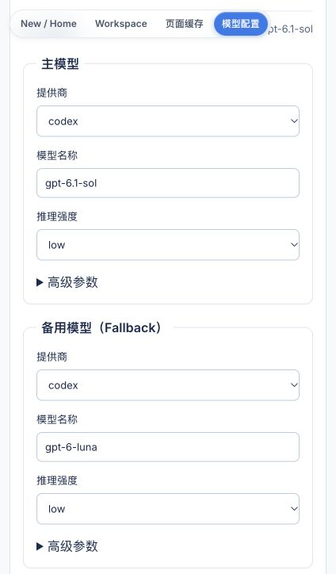

# 后台可视化模型配置

在后台顶部导航选择“模型配置”，或打开本机后台的 `/settings/models`。主页设置引导和缓存探索区域也提供链接。可视化编辑与手动编辑使用同一份有效配置，不额外引入一套数据库配置。

## 模型与角色

- 默认模型：提供商、模型名称、推理强度，以及备用模型。
- 角色覆盖：展开 Planner、Operator、Explorer、Checker 等角色；页面学习使用 `object_detector`，Monkey 探索使用 `operator`。未设置的字段显示继承来源，清空角色字段并保存可以恢复该字段的默认继承。
- 高级参数：温度、主模型请求超时、Thinking Level、Thinking Budget、思考输出和 grounding；是否支持取决于提供商和模型。

修改默认模型不会自动清空已有角色覆盖。若需要统一模型，请逐项调整角色中的覆盖值；主模型和备用模型需要分别确认。页面不自动切换提供商、不自动添加其他提供商凭证，也不自动触发付费推理。保存只验证配置结构、字段范围和完整性，不代表模型名称、账号权益或图片推理已验证。

模型名称支持自由输入，不硬编码易过时的模型列表。提供商列表来自当前运行版本支持的类型；页面不会宣称该版本尚未实现的适配器可用。

## 保存和生效

“保存模型配置”只写入改动字段，保留 JSONC 注释、其他角色字段、预设以及 `agent` 等运行配置。保存使用临时文件与原子替换，目标文件权限为仅当前用户可读写。保存时检查读取版本；若文件已被手工或另一个页面修改，返回冲突并保留本页草稿，不覆盖外部改动。

“重新加载”明确放弃当前未保存编辑，读取文件最新内容。保存失败时不会清空草稿。旧版完全展开的模型文件不在首版可视化编辑范围内，页面会提示先迁移到 `default/nodes` 格式；格式损坏时也不会强行重写文件。仅有打包只读模板的安装，在首次实际修改时保存为用户应用目录中的可写配置；源码模式编辑当前解析到的配置文件。

新任务会读取新配置；已运行任务保持启动时配置。外部 MCP 客户端会话需要重启。暂停的缓存探索任务冻结了已授权模型路由；如果改动影响它使用的模型，需要停止旧任务并重新创建、确认，不能继续旧授权。手动编辑文件的方式保留，环境变量 `ARTEMIS_ARTEMIS_JSONC` 仍可选择已有配置。

## 登录和凭证

Codex 使用“打开 Codex 登录与推理验证”里的现有认证入口；不需要填写其他提供商的 API Key。实际推理验证由用户单独点击，不随保存自动执行。

API Key 支持 Google、OpenAI、Anthropic、OpenRouter、xAI 和 OCR。页面只显示是否配置；新 Key 用密码输入框输入，成功或失败后都会清空。点击“验证并保存 API Key”会调用所选提供商的现有验证接口，通过后才原子保存到本机 `.env` 并激活。写入失败会报告失败，不能把仅内存生效当作持久化成功。空输入不会删除已有 Key，也不需要重输未修改的 Key。不要把 Key 写在模型名称里。

模型配置 API 不返回原始配置文件、Key 或 Key 片段；凭证接口错误不回传供应商原始错误文本。读写接口限定本机同源后台，修改还要求专用请求头。数据不上传到远程配置服务，不提交 Git。界面截图或报告也应避开私人数据和凭证。

Vertex AI 的 ADC、自定义服务地址 `OPENAI_BASE_URL`、其他环境与代理参数沿用已有配置方式，本页首版不修改它们。自定义地址用户在验证 Key 前应确认现有地址指向预期服务。

## 验证

相关后端测试：`tests/unit/admin_console/test_model_settings.py`；前端测试：`apps/showcase_ui/src/app/pages/model-settings/model-settings.component.spec.ts`。覆盖字段局部更新、继承恢复、原配置保留、版本冲突、本机权限边界、密钥错误脱敏以及保存失败清理等情况。

2026-10-27 验证：相关 Python 回归 330 项通过、2 项跳过，前端 219 项通过，生产构建及 Ruff 检查通过。本机后台实际页面完成超时参数 180 → 181 → 180 的保存回读，最终配置文件与验证前逐字节一致。已有无关本地文件保持不变。凭证写入和异常流程使用临时文件及受控验证接口测试，没有向外发送新的真实 Key；本轮也没有额外执行付费模型推理。

