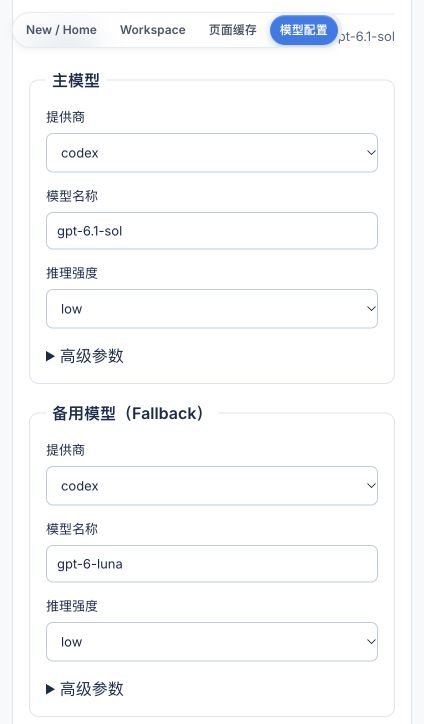
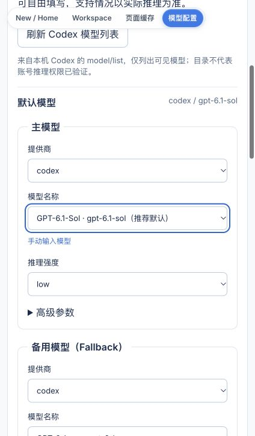

# Visual model settings

[中文](./model-settings.md)

Choose **Model Settings** in the console navigation or open `/settings/models`. The home setup wizard and cache exploration area also link to this page. Visual and manual editing use the same effective configuration file.

## Models and roles

- Set the default provider, model, reasoning effort, and fallback model.
- Expand roles such as Planner, Operator, Explorer, and Checker to override individual fields. Page learning uses `object_detector`, and Monkey exploration uses `operator`. Empty fields show their inheritance source. Clear a field and save to restore inheritance.
- Advanced options include temperature, primary-request timeout, Thinking Level, Thinking Budget, thought output, and grounding. Availability depends on the provider and model.

Changing the default model preserves role overrides. Adjust those separately when unifying models, and check primary and fallback choices individually. Saving validates structure, ranges, and completeness. Model availability, account access, and image inference require their own checks. The page does not automatically change providers, add credentials, or run paid inference.

Codex model selectors read the local App Server's `model/list` catalog. They support default, inherited, overridden, and fallback models, with hidden-model filtering, pagination, short caching, and manual refresh. Reading the catalog does not start inference or consume inference Tokens. Catalog entries do not establish account access. [Official App Server documentation](https://learn.chatgpt.com/docs/app-server#list-models-modellist)

Manual input remains available if catalog loading fails. Existing models absent from the catalog stay configured and are labeled accordingly. Other providers use free-text model names. The provider list reflects adapters implemented by the running version.

## Saving and applying changes

**Save model settings** writes changed fields while preserving JSONC comments, other roles, presets, and runtime settings such as `agent`. Writes use a temporary file and atomic replacement. POSIX files use `0600` permissions. On Windows, directory ACLs determine access rather than POSIX permission bits. If the file changed since it was loaded, saving returns a conflict and keeps the draft.

**Reload** discards the current draft and reads the latest file. A failed save preserves the draft. Legacy fully expanded model files require migration to `default/nodes` before visual editing. Malformed files are not forcibly rewritten. Installations with only a packaged read-only template create a writable user configuration on the first actual edit. Source checkouts edit the resolved configuration file.

New tasks read the updated configuration. Running tasks retain their initial settings, and external MCP sessions need restarting. Paused cache exploration tasks retain the authorized model routes. If those routes change, stop the task and create and authorize another one. Manual file editing and the `ARTEMIS_ARTEMIS_JSONC` override remain supported.

## Sign-in and credentials

Use **Open Codex sign-in and inference verification** for Codex authentication. Inference verification is a separate user action, independent of saving settings.

API key entry supports Google, OpenAI, Anthropic, OpenRouter, xAI, and OCR. The page shows whether a key is configured. New keys use password inputs that clear after success or failure. **Verify and save API key** calls the provider's validation endpoint, then atomically saves the key to the local `.env` and activates it. A disk-write failure reports failure. Blank inputs preserve existing keys, and unchanged keys need not be entered again. Keep credentials out of model names.

The model settings API omits raw configuration files and credentials. Credential errors omit provider error text that could contain secrets. Endpoints require local, same-origin access, and mutations require a dedicated request header. Configuration stays local and outside Git. Exclude credentials and private data from screenshots and reports.

Vertex AI ADC, `OPENAI_BASE_URL`, proxy settings, and other environment options continue to use existing configuration methods. Check custom service destinations before validating keys.

## Screenshots

