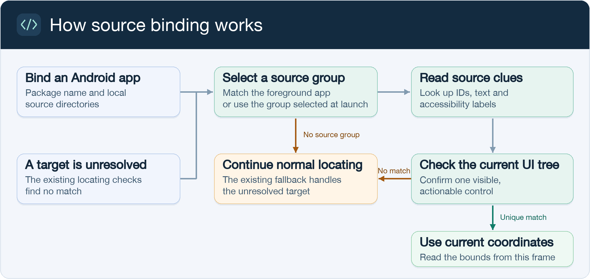

# Source binding

[中文](./source-binding_CN.md) · [Project README](../README.md)

Bind an Android package name to local source directories so ARTEMIS can use control IDs and labels as locating hints. Source lookup is read-only and works with the app already installed on the device.

## Set up a source group

1. Open **Project Source** in the console and select **Add source group**. Enter an Android package name directly or choose an app from a connected device.
2. Name the group and give the absolute path to the main project directory on the computer running ARTEMIS. Add any extra module directories as absolute paths, one per line.
3. Save the group. When you run a task from the local console, ARTEMIS automatically uses a unique binding for the actual foreground package. If that package has multiple source groups, use **Task source group (optional)** to select the one that matches the installed build.

## Locating workflow

For unresolved targets, ARTEMIS extracts the control name and constraints such as role and position from the original description, then searches the bound directories. When the full description has a source match, ARTEMIS checks that evidence first.

| Stack | Source hints |
| --- | --- |
| Flutter | ARB files, configured translation resources, Dart widget declarations, and `Semantics.identifier` |
| React Native | JSX `testID`, accessibility labels, and static control text |
| Android Views | Resource IDs, text, descriptions, and `@string` references in layout and menu XML |
| Jetpack Compose | `testTag`, static text, `contentDescription`, and resolvable `R.string` references |

Coordinates come from the device's current native UI tree. The control must be visible, enabled, clickable, and unique in the current frame. A changed observation, an obscured target, or missing or ambiguous source evidence sends the target to the existing fallback.

## Compare on a device

**Project Source** also shows cumulative hits, fallbacks, and average time per batch. Estimated time saved uses comparable samples from past visual locating calls.

In **Project Source**, select a device and source group, open the target page on the device, and enter the target description plus the exact expected control text or full ID for independent scoring. A and B use the same frame to compare locating accuracy, vision calls, and time for that target. The comparison observes the screen in read-only mode and runs locally by default. Authorize screenshot use to include the configured vision model as a fallback.
