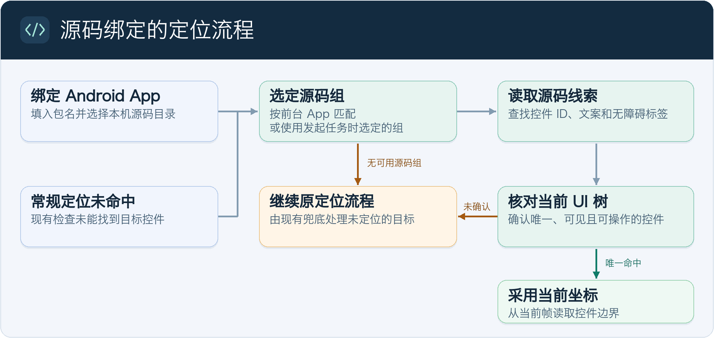

# 源码绑定

[English](./source-binding.md) · [项目首页](../README_CN.md)

把 Android 应用包名与本机源码目录绑定后，ARTEMIS 可以用源码中的控件 ID 和文案辅助定位。ARTEMIS 只读源码，任务直接使用设备上已安装的 App。

## 配置源码组

1. 在后台打开 **工程源码**，选择 **绑定应用**。可手动输入 Android 包名，也可从已连接设备的应用列表选择。**应用名称**可选，用于显示和搜索，同一包名的所有源码组共用。已绑定的应用可以在卡片上选择 **新增源码组**。
2. 源码组名称默认填为 **主工程**，也可以自行修改。填写运行 ARTEMIS 的电脑上的主工程绝对路径。有额外的源码模块时，可在附加目录中每行填写一个绝对路径。
3. 保存源码组。从本机控制台运行任务时，ARTEMIS 按实际前台应用包名自动匹配唯一绑定。一个包名对应多个源码组时，在任务表单的 **任务源码组（可选）** 中选择与设备安装版本对应的一组。

## 定位流程

对于常规定位仍未解决的目标，ARTEMIS 从原始描述提取控件名称及角色、位置等约束，在绑定目录中查找候选。完整描述已有源码线索时，优先核对该线索。

同一工程混用多种技术栈时，ARTEMIS 会汇总各技术栈的源码线索，再用同一份实时 UI 树核对。

| 技术栈 | 可用的源码线索 |
| --- | --- |
| Flutter | ARB、已配置的翻译资源、Dart 控件声明和 `Semantics.identifier` |
| React Native | JSX 中的 `testID`、无障碍标签和静态控件文案 |
| Android Views | XML 布局及菜单中的资源 ID、文字、描述和 `@string` 引用 |
| Jetpack Compose | `testTag`、静态文案、`contentDescription` 和可解析的 `R.string` 引用 |

坐标取自当前设备的原生 UI 树。控件必须可见、启用、可点击，且在当前画面中唯一匹配。画面变化、控件被遮挡、候选歧义或找不到线索时，任务继续走原定位流程。

## 真机定位对照

**工程源码**页还显示累计命中数、回退数和每批平均耗时。预计节省时间根据可比的历史视觉定位样本估算。

在 **工程源码** 中选定设备和源码组，在设备上打开目标页面，然后填写定位描述及可独立核对的预期控件文字或完整 ID。A、B 两组在同一帧比较定位正确性、视觉调用次数和单目标定位耗时，整个对照只读观察。默认使用本地定位，勾选截图授权后可按需调用配置的视觉模型。
